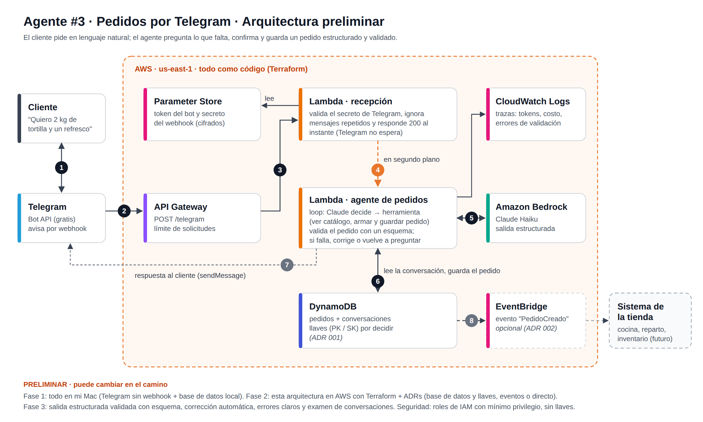

# Agente de Pedidos por Telegram 🤖🛒

Agente de IA que conversa con clientes por **Telegram**, entiende pedidos escritos en lenguaje natural, **pregunta lo que falta**, confirma y guarda el pedido como **datos estructurados y validados** en una base de datos.

> El negocio es **ficticio** (Abarrotes Don Chuy), creado solo para este proyecto.

**Ejemplo:**

> Cliente: *"Quiero 2 kilos de tortilla y un refresco de 2 litros"*
> Agente: *"¿A qué dirección te lo llevo y cómo vas a pagar?"*
> … y al confirmar, se guarda un pedido con productos, cantidades, dirección y forma de pago.

## Fases del proyecto

- [x] **Fase 1:** Loop del agente y la conversación, todo en mi Mac (examen 8/8)
- [ ] **Fase 2:** En AWS con **Terraform**: webhook de Telegram, Lambdas, fila **SQS FIFO** con DLQ, base de datos y secretos (con ADRs de las decisiones)
- [ ] **Fase 3:** Salida estructurada validada con esquema, corrección automática, errores claros y examen de conversaciones

## Arquitectura (preliminar)

## Qué demuestra este proyecto

- **Salida estructurada (structured output):** el agente no devuelve texto suelto, sino datos con una forma exacta.
- **Validación con esquema:** qué pasa cuando los datos están mal, cómo se corrigen y cómo se reporta el error.
- **Modelado de datos:** qué base de datos elegir y cómo diseñar sus llaves, documentado en un ADR.
- **Integración:** webhook seguro de Telegram, secretos cifrados y, opcionalmente, eventos para otros sistemas.
- **Mensajes que no se pierden:** una fila **SQS FIFO** entre la recepción y el agente mantiene el orden de cada conversación, reintenta si algo falla, ignora duplicados y manda a una fila de mensajes muertos (DLQ) lo que falla varias veces.
- **Infraestructura como código** con Terraform.

## Examen de conversaciones (Fase 1)

`examen_conversaciones.py` hace de **cliente falso**: le escribe al agente pláticas completas (sin Telegram) y revisa **con datos**, no a ojo, si guardó el pedido cuando debía, si el total es correcto, si usó códigos que existen, si ofreció productos agotados y si dio algún folio falso.

| Intento | Resultado | Qué encontró | Qué cambié |
|---|---|---|---|
| 1 | 6/8 | Inventaba códigos de producto; ofrecía un producto agotado | Los ids van en la lista de productos de las instrucciones |
| 2 | 6/8 | **Agregó dos veces el mismo producto: el cliente iba a pagar $168 en lugar de $84** | Agregar ahora "deja en N" (idempotente) y el código le recuerda a Claude cómo va el pedido en cada mensaje |
| 3 | 7/8 | Seguía ofreciendo el agotado aunque decía "AGOTADO" | Los agotados van en una lista aparte, armada en cada mensaje |
| 4 | **8/8** | — | — |

**Lección principal:** la memoria guarda lo que el modelo *dijo*, no lo que *hizo*. Lo importante (el pedido, las existencias) lo lleva el código y se le muestra al modelo en cada mensaje; las reglas escritas solas no bastan.

## Proyectos anteriores

- [Agente Investigador](https://github.com/elfuturoconalex/agente-investigador): investiga en la web y deja informes en S3.
- [Agente de Soporte Interno](https://github.com/elfuturoconalex/agente-soporte-interno): responde con los documentos de la empresa (RAG), cita fuentes y dice "no lo sé". Examen automático: 25/25.
