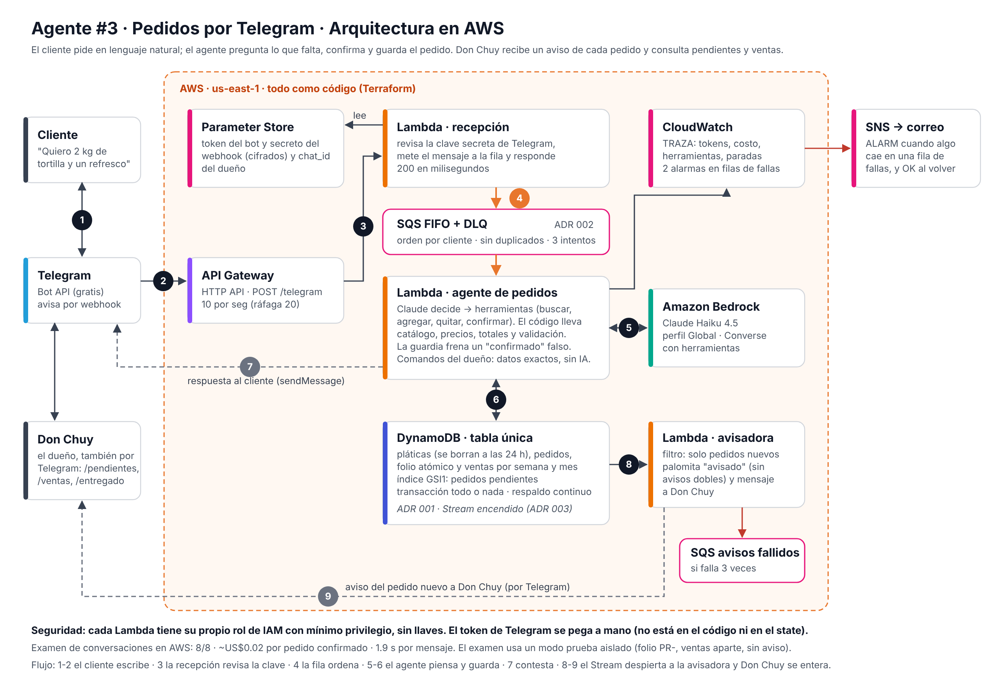

# Agente de Pedidos por Telegram

Agente de IA que conversa con clientes por **Telegram**, entiende pedidos escritos en lenguaje natural, **pregunta lo que falta**, confirma y guarda el pedido como **datos estructurados y validados**. El dueño recibe un **aviso de cada pedido** y consulta sus pendientes y ventas desde el mismo Telegram.

> El negocio es **ficticio** (Abarrotes Don Chuy), creado solo para este proyecto.

> **English summary:** Telegram ordering agent for a small store, running on AWS and built 100% with Terraform: API Gateway webhook (secret-token check) → receiver Lambda → SQS FIFO + DLQ → agent Lambda (Claude Haiku 4.5 on Bedrock with tools) → DynamoDB single-table design (atomic order numbers, all-or-nothing transactions, sales ledgers, sparse GSI for pending orders). DynamoDB Streams wakes a notifier Lambda that alerts the owner; owner commands return exact figures from the table without the LLM. CloudWatch alarms on both failure queues email via SNS. Least-privilege IAM per Lambda, no keys. Conversation eval run against the real Lambda in an isolated test mode: 8/8, ~US$0.02 per confirmed order, 1.9 s per message. Design decisions in 3 ADRs.

**Ejemplo:**

> Cliente: *"Quiero 2 kilos de tortilla y un refresco de 2 litros"*
> Agente: *"¿A qué dirección te lo llevo y cómo vas a pagar?"*
> … y al confirmar, se guarda el pedido con su folio y a Don Chuy le llega el aviso.

## Fases del proyecto

- [x] **Fase 1:** Loop del agente y la conversación, todo en mi Mac (examen 8/8)
- [x] **Fase 2:** En AWS con **Terraform**: webhook de Telegram, Lambdas, fila **SQS FIFO** con DLQ, DynamoDB, secretos, aviso al dueño y alarmas (3 ADRs, examen en AWS 8/8)
- [ ] **Fase 3:** Salida estructurada validada con esquema, reglas más estrictas (dirección, consulta de precios) y examen de 20–30 conversaciones

## Arquitectura en AWS



1. El cliente escribe en Telegram, y Telegram avisa por **webhook** a **API Gateway**.
2. La **Lambda de recepción** revisa la clave secreta del webhook, mete el mensaje a la **fila SQS FIFO** y responde en milisegundos.
3. La **Lambda del agente** toma los mensajes en orden: Claude decide qué herramienta usar y el código lleva catálogo, precios, totales y validación. Lee y guarda la plática y el pedido en **DynamoDB**, y contesta por Telegram.
4. Cuando se crea un pedido, el **Stream** de DynamoDB despierta a la **Lambda avisadora**, que le avisa a Don Chuy.
5. Si un mensaje o un aviso falla 3 veces, cae en su fila de fallas y una **alarma de CloudWatch** manda un correo por **SNS**.

*El diagrama preliminar del inicio del proyecto sigue en [docs/arquitectura-preliminar.png](docs/arquitectura-preliminar.png), para comparar lo planeado con lo construido.*

## Decisiones de arquitectura (ADRs)

| ADR | Decisión | Por qué |
|---|---|---|
| [001](docs/adr/001-base-de-datos.md) | **DynamoDB**, tabla única con llaves PK/SK | Sin servidor, se paga por uso; folio atómico y transacciones "todo o nada" |
| [002](docs/adr/002-fila-sqs.md) | **SQS FIFO + DLQ** entre la recepción y el agente | Ningún mensaje perdido, ninguno duplicado y cada plática en orden |
| [003](docs/adr/003-aviso-al-dueno.md) | **DynamoDB Streams** + Lambda avisadora; comandos del dueño **sin IA** | El aviso nace del pedido ya guardado; los números de dinero salen exactos de la tabla |

## Qué demuestra este proyecto

- **Agente con herramientas:** Claude decide qué buscar, qué agregar y cuándo confirmar; el código es dueño de los precios y los totales.
- **Guardia en código:** si Claude dice "confirmado" sin haber guardado el pedido, el código lo detiene. Actuó en los dos pedidos reales de prueba.
- **Arquitectura asíncrona y desacoplada:** la recepción contesta al instante y el trabajo pesado va por una fila; el aviso al dueño reacciona a lo que se guarda, sin tocar al agente.
- **Idempotencia:** marca de "ya procesado" por mensaje, "agregar deja en N", palomita condicional de "avisado" y "entregado" que no se marca dos veces.
- **Modelado de datos:** tabla única, índice disperso de pendientes, libretas de ventas por semana y mes con contadores atómicos.
- **Seguridad:** clave secreta en el webhook, secretos cifrados en Parameter Store (el token nunca pasa por Terraform), un rol de IAM con mínimo privilegio por Lambda y sin llaves.
- **Observabilidad:** cada mensaje deja una TRAZA (herramientas, tokens, costo, motivo de parada, tiempo), sin textos del cliente; alarmas en las filas de fallas, probadas de punta a punta.
- **Infraestructura como código:** todo con Terraform (31 recursos), incluido el examen en AWS.

## Números reales (Fase 2)

| Dato | Valor |
|---|---|
| Examen de conversaciones en AWS | **8/8** |
| Costo por pedido confirmado | ~US$0.02 (examen) a ~US$0.04 (pedido real de 8 mensajes) |
| Respuesta del agente | 1.9 s por mensaje en promedio |
| Recepción → "ok" a Telegram | 9 a 250 ms |
| Aviso a Don Chuy | ~1.3 s después de guardar el pedido |
| Infraestructura fija | Sin costo fijo: todo se paga por uso |

## Examen de conversaciones en AWS (Fase 2)

`examen_aws.py` corre los mismos 8 casos de la Fase 1 contra el **agente real**: invoca la Lambda directo con la etiqueta `"prueba": true`, así que usa Claude en Bedrock y DynamoDB de verdad, pero sin Telegram ni la fila.

El **modo prueba** está aislado, como una VLAN de pruebas dentro de producción: los pedidos llevan folio `PR-`, van a su propia libreta de ventas, no salen en `/pendientes` y no se le avisan al dueño. Desde Telegram no se puede activar: la recepción arma el mensaje solo con 4 campos fijos.

**Resultado: 8/8**, con un costo total de US$0.10 por las 22 respuestas.

**Lección:** el examen revisa *datos* (pedido, total, folio), no *cómo* llegó ahí. Al leer las pláticas encontré que el agente dice qué hay y qué no hay **sin consultar la herramienta**, porque esa lista ya va en sus instrucciones. No mintió, pero las instrucciones se contradicen; se corrige en la Fase 3.

## Examen de conversaciones (Fase 1)

`examen_conversaciones.py` hace de **cliente falso**: le escribe al agente pláticas completas (sin Telegram) y revisa **con datos**, no a ojo, si guardó el pedido cuando debía, si el total es correcto, si usó códigos que existen, si ofreció productos agotados y si dio algún folio falso.

| Intento | Resultado | Qué encontró | Qué cambié |
|---|---|---|---|
| 1 | 6/8 | Inventaba códigos de producto; ofrecía un producto agotado | Los ids van en la lista de productos de las instrucciones |
| 2 | 6/8 | **Agregó dos veces el mismo producto: el cliente iba a pagar $168 en lugar de $84** | Agregar ahora "deja en N" (idempotente) y el código le recuerda a Claude cómo va el pedido en cada mensaje |
| 3 | 7/8 | Seguía ofreciendo el agotado aunque decía "AGOTADO" | Los agotados van en una lista aparte, armada en cada mensaje |
| 4 | **8/8** | — | — |

**Lección principal:** la memoria guarda lo que el modelo *dijo*, no lo que *hizo*. Lo importante (el pedido, las existencias) lo lleva el código y se le muestra al modelo en cada mensaje; las reglas escritas solas no bastan.

## Cómo desplegarlo

Requisitos: cuenta de AWS con acceso por **IAM Identity Center** (sin llaves), Terraform y un bot de Telegram creado con @BotFather.

```bash
aws sso login --profile personal
cd infra
echo 'correo_alertas = "<TU-CORREO>"' > terraform.tfvars   # no se sube a GitHub
terraform init
terraform apply
```

Después del primer `apply`:

1. Pegar el token del bot en Parameter Store (`/agente-pedidos/telegram/bot-token`) desde la consola de AWS. Terraform solo crea el cajón con un valor de relleno, para que el token nunca quede en el código ni en el state.
2. Confirmar el correo de alertas (llega de AWS Notifications).
3. Registrar el webhook en Telegram con la dirección de API Gateway (`<MI-API>`) y la clave secreta que generó Terraform.
4. El dueño le escribe al bot una vez y su `chat_id` se guarda en `/agente-pedidos/dueno/chat-id`.

Examen en AWS, desde la raíz del repo: `python examen_aws.py`.

## Proyectos anteriores

- [Agente Investigador](https://github.com/elfuturoconalex/agente-investigador): investiga en la web y deja informes en S3.
- [Agente de Soporte Interno](https://github.com/elfuturoconalex/agente-soporte-interno): responde con los documentos de la empresa (RAG), cita fuentes y dice "no lo sé". Examen automático: 25/25.
